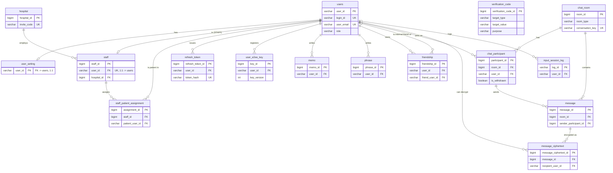

# LookTalk Database

이 문서는 실제 Flyway migration(`src/main/resources/db/migration/V1~V7`)과 JPA Entity를 직접 대조해 작성한 현재 PostgreSQL 스키마 문서다. API 계약이 아니라 **DB 구조 자체**를 설명한다.

## 1. Database 개요

- DBMS: PostgreSQL 17
- Schema 변경 이력: Flyway migration `V1__init.sql` ~ `V7__fix_chat_participant_withdrawal_check.sql`
- JPA는 `spring.jpa.hibernate.ddl-auto: validate`만 사용한다 — Hibernate가 스키마를 생성/변경하지 않고, Entity 매핑이 실제 테이블과 일치하는지만 기동 시점에 검증한다.
- 따라서 **실제 schema의 Source of Truth는 Flyway migration 파일**이다. Entity는 그 결과를 Java 코드로 반영한 것이며, 이 문서의 컬럼 표는 migration 원문을 기준으로 작성하고 Entity는 컬럼명이 실제와 다르게 매핑된 경우(예: Java 필드명 `ciphertext` ↔ DB 컬럼명 `content`)를 확인하는 용도로만 사용했다.
- 기존에 적용된 V1~V7은 수정하지 않으며, 앞으로의 스키마 변경은 항상 다음 버전(V8~)으로 추가한다.

---

## 2. 전체 ERD

PK/FK와 핵심 식별 컬럼만 표현했다. 관계는 전부 실제 migration의 `REFERENCES` 절을 그대로 옮긴 것이며, 임의로 추정한 관계는 없다.



`verification_code`는 `target_value`가 이메일/전화번호 문자열일 뿐 다른 테이블을 FK로 참조하지 않아 관계선이 없다(위 ERD에도 관계를 그리지 않았다).

> 나중에 `docs/assets/database/looktalk-erd.png`(예: DBeaver로 뽑은 ERD 이미지)가 실제로 추가되면 이 Mermaid ERD 아래에 보조 이미지로 넣을 수 있다. 현재는 이미지 파일이 저장소에 없으므로 링크하지 않았다.

---

## 3. 테이블 목록

| 테이블 | 역할 | 주요 관계 | 현재 Backend 사용 여부 |
|---|---|---|---|
| `users` | 전체 사용자(PATIENT/STAFF) 계정 | 거의 모든 테이블의 중심(FK 대상) | 사용 중 |
| `user_setting` | PATIENT의 입력 방식 설정 | `users`와 1:1 | 사용 중 |
| `hospital` | 병원(의료진 초대코드 발급 단위) | `staff`가 참조 | 사용 중 |
| `staff` | 의료진 - `users` 1:1 확장 | `users`, `hospital` 참조 / `staff_patient_assignment` 대상 | 사용 중 |
| `staff_patient_assignment` | 의료진-환자 담당 관계 | `staff`, `users`(patient) 참조 | 사용 중(채팅 권한과는 무관) |
| `verification_code` | 이메일/SMS 인증번호(해시) | 독립 테이블(FK 없음) | 사용 중 |
| `refresh_token` | Refresh Token 해시 저장 | `users` 참조 | 사용 중 |
| `user_e2ee_key` | 사용자 E2EE 공개키 | `users` 참조 | 사용 중 |
| `memo` | 암호화된 개인 메모 | `users` 참조 | 사용 중 |
| `phrase` | 암호화된 자주 쓰는 문장(최대 3개) | `users` 참조 | 사용 중 |
| `friendship` | 외부 SMS 지인 목록 | `users`(owner/optional internal friend) 참조 | 사용 중 |
| `chat_room` | 채팅방(HOSPITAL/SMS) | `chat_participant`, `message` 대상 | 사용 중 |
| `chat_participant` | 채팅방 참여자(내부 회원/외부 SMS/탈퇴 회원) | `chat_room`, `users` 참조 / `message` 대상 | 사용 중 |
| `message` | 채팅 메시지 메타데이터(본문 없음) | `chat_room`, `chat_participant` 참조 / `message_ciphertext` 대상 | 사용 중 |
| `message_ciphertext` | 사용자별 메시지 ciphertext | `message`, `users`(recipient) 참조 | 사용 중 |
| `input_session_log` | 입력 방식별 세션 분석 로그 | `users` 참조 | **스키마 존재 / 기능 구현 보류** — Entity/Repository/Service/Controller 없음 |

`app_health_check`는 V1에서 생성되었다가 V6에서 삭제되어 **현재 스키마에 존재하지 않는다**(7절 Migration 이력에서만 다룬다).

---

## 4. 테이블 상세

컬럼 표는 V1~V7 적용 후 **현재 최종 상태**를 기준으로 작성했다(중간 버전의 임시 상태가 아니다).

### users

| Column | Type | Nullable | Default | Constraint | 설명 |
|---|---|---|---|---|---|
| user_id | VARCHAR(50) | NOT NULL | - | PK | 내부 식별자(UUID 문자열). 화면 표시용으로 쓰지 않는다 |
| user_name | VARCHAR(50) | NULL | - | - | 선택 입력 이름(V5에서 NOT NULL 해제). NULL이면 표시 이름은 login_id |
| user_email | VARCHAR(100) | NOT NULL | - | UNIQUE | 가입/비밀번호 재설정용 이메일 |
| user_pwd | VARCHAR(255) | NOT NULL | - | - | BCrypt 해시(평문 저장 안 함) |
| user_phone | VARCHAR(20) | NULL | - | - | SMS 인증 완료된 본인 전화번호 |
| profile_image | TEXT | NULL | - | - | |
| is_email_verified | BOOLEAN | NULL | FALSE | - | |
| is_sms_verified | BOOLEAN | NULL | FALSE | - | |
| reset_token | VARCHAR(255) | NULL | - | - | 비밀번호 재설정 토큰의 SHA-256 해시 |
| reset_token_expiry | TIMESTAMPTZ | NULL | - | - | |
| created_at | TIMESTAMPTZ | NULL | CURRENT_TIMESTAMP | - | |
| login_id | VARCHAR(50) | NOT NULL | - | UNIQUE | 로그인 아이디(V3 추가, V4에서 NOT NULL) |
| role | VARCHAR(20) | NOT NULL | - | CHECK `chk_users_role` (`PATIENT`\|`STAFF`) | V3 추가, V4에서 NOT NULL |

### user_setting

| Column | Type | Nullable | Default | Constraint | 설명 |
|---|---|---|---|---|---|
| user_id | VARCHAR(50) | NOT NULL | - | PK, FK → users(user_id) ON DELETE CASCADE | PK 자체가 FK(1:1) |
| keyboard_layout | VARCHAR(20) | NULL | 'QWERTY' | - | |
| is_key_enlarged | BOOLEAN | NULL | FALSE | - | |
| current_input_method | VARCHAR(30) | NULL | 'EYE_TRACKING' | - | Entity에서 `InputMethod` enum(EYE_TRACKING/BLINK/MOUTH)로 사용, DB에는 CHECK 없음 |
| updated_at | TIMESTAMPTZ | NULL | CURRENT_TIMESTAMP | - | |

### hospital

| Column | Type | Nullable | Default | Constraint | 설명 |
|---|---|---|---|---|---|
| hospital_id | BIGSERIAL | NOT NULL | - | PK | |
| hospital_name | VARCHAR(100) | NOT NULL | - | - | |
| invite_code | VARCHAR(50) | NOT NULL | - | UNIQUE | 의료진 회원가입 시 사용하는 초대코드 |
| created_at | TIMESTAMPTZ | NULL | CURRENT_TIMESTAMP | - | |

### staff

| Column | Type | Nullable | Default | Constraint | 설명 |
|---|---|---|---|---|---|
| staff_id | BIGSERIAL | NOT NULL | - | PK | |
| user_id | VARCHAR(50) | NOT NULL | - | UNIQUE, FK → users(user_id) ON DELETE CASCADE | users와 1:1 확장 |
| hospital_id | BIGINT | NOT NULL | - | FK → hospital(hospital_id), ON DELETE 미지정(기본 NO ACTION) | hospital이 참조되는 동안 삭제 불가 |
| created_at | TIMESTAMPTZ | NULL | CURRENT_TIMESTAMP | - | |

인덱스: `ix_staff_hospital_id`(hospital_id)

### staff_patient_assignment

| Column | Type | Nullable | Default | Constraint | 설명 |
|---|---|---|---|---|---|
| assignment_id | BIGSERIAL | NOT NULL | - | PK | |
| staff_id | BIGINT | NOT NULL | - | FK → staff(staff_id) ON DELETE CASCADE | |
| patient_user_id | VARCHAR(50) | NOT NULL | - | FK → users(user_id) ON DELETE CASCADE | |
| assigned_at | TIMESTAMPTZ | NOT NULL | CURRENT_TIMESTAMP | - | |

제약: `uq_staff_patient_assignment` UNIQUE(staff_id, patient_user_id) — 동일 담당 관계 중복 방지
인덱스: `ix_staff_patient_assignment_staff_id`, `ix_staff_patient_assignment_patient_user_id`

### verification_code

| Column | Type | Nullable | Default | Constraint | 설명 |
|---|---|---|---|---|---|
| verification_code_id | BIGSERIAL | NOT NULL | - | PK | |
| target_type | VARCHAR(10) | NOT NULL | - | CHECK `chk_verification_code_target_type` (`EMAIL`\|`SMS`) | |
| target_value | VARCHAR(100) | NOT NULL | - | - | 이메일 주소 또는 정규화된 전화번호(FK 아님) |
| code_hash | VARCHAR(64) | NOT NULL | - | - | V3의 `code`(VARCHAR(10), 원문) → V6에서 `code_hash`(VARCHAR(64))로 rename + HMAC-SHA256 해시로 전환 |
| expires_at | TIMESTAMPTZ | NOT NULL | - | - | |
| verified_at | TIMESTAMPTZ | NULL | - | - | |
| created_at | TIMESTAMPTZ | NULL | CURRENT_TIMESTAMP | - | |
| purpose | VARCHAR(30) | NOT NULL | - | CHECK `chk_verification_code_purpose` (`SIGNUP`\|`PASSWORD_RESET`\|`PHONE_VERIFY`) | V4 추가 |

인덱스: `ix_verification_code_target`(target_type, target_value), `ix_verification_code_lookup`(target_type, target_value, purpose)

### refresh_token

| Column | Type | Nullable | Default | Constraint | 설명 |
|---|---|---|---|---|---|
| refresh_token_id | BIGSERIAL | NOT NULL | - | PK | |
| user_id | VARCHAR(50) | NOT NULL | - | FK → users(user_id) ON DELETE CASCADE | |
| token_hash | VARCHAR(64) | NOT NULL | - | UNIQUE | Refresh Token 원문의 SHA-256 해시(원문은 저장 안 함) |
| expires_at | TIMESTAMPTZ | NOT NULL | - | CHECK `chk_refresh_token_expiry` (expires_at > created_at) | |
| revoked_at | TIMESTAMPTZ | NULL | - | - | |
| created_at | TIMESTAMPTZ | NOT NULL | CURRENT_TIMESTAMP | - | |

인덱스: `ix_refresh_token_user_id`(user_id), `ix_refresh_token_active_user`(user_id, expires_at) WHERE revoked_at IS NULL

### user_e2ee_key

| Column | Type | Nullable | Default | Constraint | 설명 |
|---|---|---|---|---|---|
| key_id | BIGSERIAL | NOT NULL | - | PK | |
| user_id | VARCHAR(50) | NOT NULL | - | FK → users(user_id) ON DELETE CASCADE | |
| key_version | INTEGER | NOT NULL | - | CHECK `chk_user_e2ee_key_version` (>= 1) | 사용자별 1부터 순차 증가 |
| public_key | TEXT | NOT NULL | - | CHECK `chk_user_e2ee_public_key_not_blank` (BTRIM(public_key) <> '') | Base64 인코딩 공개키(개인키는 저장 안 함) |
| created_at | TIMESTAMPTZ | NOT NULL | CURRENT_TIMESTAMP | - | |
| revoked_at | TIMESTAMPTZ | NULL | - | - | NULL이면 active key |

제약: `uq_user_e2ee_key_version` UNIQUE(user_id, key_version)
인덱스: `ix_user_e2ee_key_active`(user_id, key_version DESC) WHERE revoked_at IS NULL — "현재 active key" 조회 전용

### memo

| Column | Type | Nullable | Default | Constraint | 설명 |
|---|---|---|---|---|---|
| memo_id | BIGSERIAL | NOT NULL | - | PK | |
| user_id | VARCHAR(50) | NOT NULL | - | FK → users(user_id) ON DELETE CASCADE | V4에서 NOT NULL |
| content | TEXT | NOT NULL | - | - | 컬럼명은 `content`이지만 V6 이후 평문이 아닌 E2EE ciphertext(Java Entity 필드명은 `ciphertext`) |
| key_version | INTEGER | NOT NULL | - | CHECK `chk_memo_key_version` (>= 1) | V6 추가 |
| encryption_algorithm | VARCHAR(40) | NOT NULL | 'LIBSODIUM_SEALED_BOX' | CHECK `chk_memo_encryption_algorithm_not_blank` | V6 추가 |
| created_at | TIMESTAMPTZ | NULL | CURRENT_TIMESTAMP | - | |
| updated_at | TIMESTAMPTZ | NULL | CURRENT_TIMESTAMP | - | |

인덱스: `ix_memo_user_id`(user_id)

### phrase

| Column | Type | Nullable | Default | Constraint | 설명 |
|---|---|---|---|---|---|
| phrase_id | BIGSERIAL | NOT NULL | - | PK | |
| user_id | VARCHAR(50) | NOT NULL | - | FK → users(user_id) ON DELETE CASCADE | V4에서 NOT NULL |
| phrase_text | TEXT | NOT NULL | - | - | 컬럼명은 `phrase_text`이지만 V6 이후 E2EE ciphertext(Java Entity 필드명은 `ciphertext`) |
| category | VARCHAR(30) | NULL | - | - | |
| key_version | INTEGER | NOT NULL | - | CHECK `chk_phrase_key_version` (>= 1) | V6 추가 |
| encryption_algorithm | VARCHAR(40) | NOT NULL | 'LIBSODIUM_SEALED_BOX' | CHECK `chk_phrase_encryption_algorithm_not_blank` | V6 추가 |
| created_at | TIMESTAMPTZ | NULL | CURRENT_TIMESTAMP | - | 최대 3개 FIFO 정렬 기준(Service 로직) |

인덱스: `ix_phrase_user_id`(user_id)

### friendship

| Column | Type | Nullable | Default | Constraint | 설명 |
|---|---|---|---|---|---|
| friendship_id | BIGSERIAL | NOT NULL | - | PK | |
| user_id | VARCHAR(50) | NOT NULL | - | FK → users(user_id) ON DELETE CASCADE | 지인 목록의 소유자. V4에서 NOT NULL |
| friend_user_id | VARCHAR(50) | NULL | - | FK → users(user_id) ON DELETE CASCADE | 현재 Backend 로직은 항상 NULL로 저장(외부 지인만 등록) |
| status | VARCHAR(20) | NULL | 'ACCEPTED' | - | DB CHECK 없음(값 집합 미확정) |
| created_at | TIMESTAMPTZ | NULL | CURRENT_TIMESTAMP | - | |
| friend_name | VARCHAR(50) | NULL | - | - | V3 추가, 등록 시점 snapshot |
| friend_phone | VARCHAR(20) | NULL | - | - | V3 추가, 정규화된(숫자만) 전화번호 |

제약: `chk_friendship_target` CHECK (friend_user_id IS NOT NULL OR friend_phone IS NOT NULL), `ux_friendship_owner_phone` UNIQUE(user_id, friend_phone) WHERE friend_phone IS NOT NULL, `ux_friendship_owner_friend_user` UNIQUE(user_id, friend_user_id) WHERE friend_user_id IS NOT NULL
인덱스: `ix_friendship_user_id`(user_id)

### chat_room

| Column | Type | Nullable | Default | Constraint | 설명 |
|---|---|---|---|---|---|
| room_id | BIGSERIAL | NOT NULL | - | PK | |
| room_type | VARCHAR(20) | NOT NULL | - | - | `HOSPITAL`\|`SMS`(DB CHECK는 없고 Backend가 이 두 값만 생성). V4에서 기본값 제거+NOT NULL |
| conversation_key | VARCHAR(200) | NULL | - | UNIQUE(부분 인덱스, `conversation_key IS NOT NULL`인 행만) | V6 추가. 1:1 room 중복 생성 방지용 |
| created_at | TIMESTAMPTZ | NULL | CURRENT_TIMESTAMP | - | |

### chat_participant

| Column | Type | Nullable | Default | Constraint | 설명 |
|---|---|---|---|---|---|
| participant_id | BIGSERIAL | NOT NULL | - | PK | |
| room_id | BIGINT | NOT NULL | - | FK → chat_room(room_id) ON DELETE CASCADE | |
| user_id | VARCHAR(50) | NULL | - | FK → users(user_id) ON DELETE SET NULL | 정상 내부 참여자만 값 존재 |
| external_name | VARCHAR(50) | NULL | - | - | 외부 SMS 참여자 snapshot |
| external_phone | VARCHAR(20) | NULL | - | - | 외부 SMS 참여자 snapshot |
| joined_at | TIMESTAMPTZ | NULL | CURRENT_TIMESTAMP | - | |
| is_withdrawn | BOOLEAN | NOT NULL | FALSE | - | V7 추가 |

제약(자세한 내용은 6절): `chk_chat_participant_identity`(V7, 3-state CHECK), `uq_chat_participant_id_room` UNIQUE(participant_id, room_id), `ux_chat_participant_room_user` UNIQUE(room_id, user_id) WHERE user_id IS NOT NULL, `ux_chat_participant_room_external_phone` UNIQUE(room_id, external_phone) WHERE external_phone IS NOT NULL
인덱스: `ix_chat_participant_room_id`(room_id)

### message

| Column | Type | Nullable | Default | Constraint | 설명 |
|---|---|---|---|---|---|
| message_id | BIGSERIAL | NOT NULL | - | PK | |
| room_id | BIGINT | NOT NULL | - | FK → chat_room(room_id) ON DELETE CASCADE | |
| sender_participant_id | BIGINT | NOT NULL | - | 복합 FK → chat_participant(participant_id, room_id) ON DELETE CASCADE (`fk_message_sender_same_room`, V6) | sender가 반드시 같은 room의 participant임을 DB가 보장 |
| message_type | VARCHAR(20) | NULL | 'TEXT' | - | DB 레벨 NOT NULL은 아님(Service가 항상 `TEXT`만 허용) |
| created_at | TIMESTAMPTZ | NULL | CURRENT_TIMESTAMP | - | |

**NOTE**: `content` 컬럼은 V6에서 완전히 제거됐다(평문 메시지를 저장하지 않는다). 실제 본문은 `message_ciphertext`에만 존재한다.

인덱스: `ix_message_room_created_at`(room_id, created_at)

### message_ciphertext

| Column | Type | Nullable | Default | Constraint | 설명 |
|---|---|---|---|---|---|
| message_ciphertext_id | BIGSERIAL | NOT NULL | - | PK | |
| message_id | BIGINT | NOT NULL | - | FK → message(message_id) ON DELETE CASCADE | |
| recipient_user_id | VARCHAR(50) | NOT NULL | - | FK → users(user_id) ON DELETE CASCADE | 이 ciphertext를 복호화할 수 있는 사용자 |
| key_version | INTEGER | NOT NULL | - | CHECK `chk_message_ciphertext_key_version` (>= 1) | recipient의 공개키 버전 |
| encryption_algorithm | VARCHAR(40) | NOT NULL | 'LIBSODIUM_SEALED_BOX' | CHECK `chk_message_ciphertext_algorithm_not_blank` | |
| ciphertext | TEXT | NOT NULL | - | CHECK `chk_message_ciphertext_not_blank` | |

제약: `uq_message_ciphertext_recipient` UNIQUE(message_id, recipient_user_id)
인덱스: `ix_message_ciphertext_recipient_user_id`(recipient_user_id)

### input_session_log

| Column | Type | Nullable | Default | Constraint | 설명 |
|---|---|---|---|---|---|
| log_id | VARCHAR(100) | NOT NULL | - | PK | |
| user_id | VARCHAR(50) | NULL | - | FK → users(user_id) ON DELETE CASCADE | |
| calibration_id | VARCHAR(100) | NULL | - | - | |
| input_method | VARCHAR(30) | NOT NULL | - | - | |
| keyboard_layout | VARCHAR(20) | NOT NULL | - | - | |
| typo_rate | REAL | NULL | - | - | |
| input_speed | REAL | NULL | - | - | |
| recognition_accuracy | REAL | NULL | - | - | |
| input_stability | REAL | NULL | - | - | |
| session_at | TIMESTAMPTZ | NULL | CURRENT_TIMESTAMP | - | |

V2에서 생성된 뒤 어떤 migration도 이 테이블을 변경하지 않았다. 이를 다루는 Entity/Repository/Service/Controller가 코드베이스에 전혀 없다(3절 참고).

---

## 5. 주요 관계

실제 FK와 cardinality를 확인한 결과다(2절 ERD와 동일한 내용을 텍스트로 정리).

- **users ↔ user_setting**: 1:1(zero-or-one). `user_setting.user_id`가 PK이자 FK. PATIENT 가입 시에만 함께 생성되며, STAFF는 이 행이 없다.
- **users ↔ staff ↔ hospital**: `staff.user_id`가 UNIQUE FK라 users:staff는 1:(zero-or-one). `staff.hospital_id`는 NOT NULL FK로 staff:hospital은 many:1.
- **staff ↔ staff_patient_assignment ↔ users(PATIENT)**: `staff_id`/`patient_user_id` 둘 다 NOT NULL FK, `(staff_id, patient_user_id)` UNIQUE로 동일 조합 중복은 불가하지만 한 staff가 여러 patient를, 한 patient가 여러 staff를 가질 수 있는 다대다 관계를 매핑 테이블로 표현한다.
- **users ↔ user_e2ee_key**: 1:many. `(user_id, key_version)` UNIQUE로 버전 관리, `revoked_at IS NULL`인 행이 최대 1개(활성 키)가 되도록 Service가 보장한다(DB 제약이 아니라 애플리케이션 로직).
- **users ↔ memo / phrase / friendship**: 전부 1:many, `ON DELETE CASCADE`로 사용자 삭제 시 함께 삭제된다.
- **chat_room ↔ chat_participant**: 1:many(`ON DELETE CASCADE`). 현재 Backend는 항상 참여자 2명(HOSPITAL: 내부 회원 2명, SMS: 내부 회원 1명 + 외부 지인 1명)으로 생성하지만, 이는 Service 로직이 강제하는 것이고 DB CHECK로 최소/최대 인원을 제약하지는 않는다.
- **chat_room ↔ message**: 1:many(`ON DELETE CASCADE`).
- **chat_participant ↔ message**: message의 sender는 복합 FK(`sender_participant_id, room_id`)로 반드시 같은 room의 participant여야 한다.
- **message ↔ message_ciphertext**: 1:many(`ON DELETE CASCADE`). 한 message가 recipient 수만큼의 ciphertext 행을 가진다(`(message_id, recipient_user_id)` UNIQUE).

---

## 6. 주요 제약조건

### chat_room.conversation_key

`chat_room(conversation_key)`에 걸린 **부분 UNIQUE 인덱스**(`conversation_key IS NOT NULL`인 행에만 적용)로 1:1 채팅방 중복 생성을 DB 레벨에서 막는다. 값 형식은 Service가 생성한다(DB는 형식을 강제하지 않는다):

```
HOSPITAL:{정렬된 작은 userId}:{정렬된 큰 userId}
SMS:{currentUserId}:{normalizedFriendPhone}
```

### chat_participant의 V7 is_withdrawn 3-state CHECK

`chk_chat_participant_identity`(V7)는 정확히 다음 세 조합만 허용한다.

| user_id | external_phone | is_withdrawn | 의미 |
|---|---|---|---|
| NOT NULL | NULL | FALSE | 정상 내부 회원 |
| NULL | NOT NULL | FALSE | 외부 SMS 지인 |
| NULL | NULL | TRUE | 탈퇴한 내부 회원 |

V4까지는 `user_id IS NOT NULL OR external_phone IS NOT NULL`만 검사해, 회원탈퇴 시 `users` DELETE의 `ON DELETE SET NULL`(V2)로 `chat_participant.user_id`가 NULL이 되는 순간 이 CHECK를 위반해 탈퇴 자체가 실패하는 문제가 있었다. V7이 `is_withdrawn` 컬럼과 위 3-state CHECK로 이를 해결했다. participant 행 자체는 삭제하지 않아 `chat_room`/`message` 이력이 보존된다.

### message_ciphertext recipient 구조

평문 메시지 본문을 저장하는 컬럼은 어디에도 없다(`message.content`는 V6에서 완전히 제거됨). 대신 **recipient 1명당 ciphertext 1행**을 `message_ciphertext`에 저장하며, `(message_id, recipient_user_id)` UNIQUE로 recipient당 정확히 1건만 존재하도록 강제한다. 조회 쿼리가 항상 `recipient_user_id = 현재 사용자`로 필터링되므로, 다른 사용자의 ciphertext가 섞일 방법이 스키마 레벨에서부터 없다.

### user_e2ee_key의 user_id + key_version

`(user_id, key_version)` UNIQUE(`uq_user_e2ee_key_version`)로 사용자별 키 버전 중복을 막는다. "현재 active 키"는 `revoked_at IS NULL`인 행으로 판단하며(DB가 "활성 키 1개"를 강제하는 CHECK는 없고, `revoked_at IS NULL`인 행을 부분 인덱스 `ix_user_e2ee_key_active`로 빠르게 조회할 뿐), 사용자당 활성 키가 항상 1개 이하로 유지되는 것은 `E2eeKeyService`가 신규 등록 시 기존 active를 모두 revoke하는 애플리케이션 로직으로 보장한다.

### friendship의 사용자별 전화번호 중복 방지

`ux_friendship_owner_phone` 부분 UNIQUE 인덱스가 `(user_id, friend_phone)` 조합을 `friend_phone IS NOT NULL`인 행에서만 유일하게 강제한다. 일반 UNIQUE 제약 대신 부분 인덱스를 쓴 이유는, PostgreSQL의 일반 UNIQUE 제약은 NULL을 서로 다른 값으로 취급해 nullable 컬럼 조합에서 사실상 무력화되기 때문이다(V3 migration 주석에도 명시).

### staff_patient_assignment 관계

`(staff_id, patient_user_id)` UNIQUE로 동일 담당 관계의 중복 등록만 막을 뿐, 이 테이블은 **담당 환자 관리 전용**이며 채팅 접근 권한(CHAT-001~006)에는 어떤 Service/Repository도 이 테이블을 참조하지 않는다.

---

## 7. Migration 이력

| Version | 주요 변경 |
|---|---|
| V1 | `app_health_check` 임시 테이블 생성(초기 헬스체크용). **V6에서 삭제되어 현재 스키마에는 없음** |
| V2 | 초기 도메인 스키마 생성: `users`, `user_setting`, `phrase`, `friendship`, `memo`, `chat_room`, `chat_participant`, `message`, `input_session_log` |
| V3 | `hospital`, `staff`, `verification_code` 테이블 추가. `users`에 `login_id`(UNIQUE, nullable), `role`(nullable, CHECK) 컬럼 추가. `friendship`에 `friend_name`/`friend_phone` 추가 + 부분 UNIQUE 인덱스 2종 |
| V4 | `users.login_id`/`role` NOT NULL 전환. `staff_patient_assignment` 테이블 신설. `verification_code.purpose` 추가(NOT NULL + CHECK). `memo`/`phrase`의 `user_id`(+`memo.content`) NOT NULL 전환 및 인덱스 추가. `friendship.user_id` NOT NULL 전환 + `chk_friendship_target` CHECK 추가. `chat_room.room_type` NOT NULL 전환(기본값 제거). `chat_participant`에 `chk_chat_participant_identity`(구버전) + 부분 UNIQUE 인덱스 2종 + 인덱스 추가. `message`에 `(room_id, created_at)` 인덱스 추가 |
| V5 | `users.user_name` NOT NULL 해제(선택 입력 정책으로 전환). 빈 문자열 데이터 NULL로 정규화 |
| V6 | `app_health_check` 삭제. `refresh_token`, `user_e2ee_key`, `message_ciphertext` 테이블 신설. `memo`/`phrase`에 `key_version`/`encryption_algorithm` 추가(E2EE 도입). `message.content` 컬럼 완전 삭제(평문 저장 금지) + sender FK를 `(sender_participant_id, room_id)` 복합 FK로 교체. `chat_room.conversation_key` 추가 + 부분 UNIQUE 인덱스(1:1 room 중복 방지). `verification_code.code` → `code_hash`로 rename(HMAC 해시 저장으로 전환, 기존 데이터는 DELETE 후 전환) |
| V7 | `chat_participant.is_withdrawn` 컬럼 추가, `chk_chat_participant_identity`를 3-state CHECK로 교체(회원탈퇴 시 500 rollback 버그 수정) |

---

## 8. 구현 상태 관련 NOTE

- **`input_session_log`**: 스키마(V2)는 존재하지만 이를 다루는 Entity/Repository/Service/Controller가 전혀 없다. CLAUDE.md 지침에 따라 테이블은 삭제하지 않고 보류 상태로 남겨뒀다. InputSession 요구사항이 확정되면 별도 설계 후 이 테이블을 사용하는 코드가 추가될 예정이다.
- **`app_health_check`**: 현재 스키마에 존재하지 않는다(V1 생성 → V6 삭제). 다른 문서나 코드에서 이 테이블을 언급하는 부분이 있다면 이미 삭제된 상태임을 감안해야 한다.
- **SMS Provider 미연동과 스키마의 관계**: `message_ciphertext`/`verification_code` 스키마 자체는 SMS Provider 연동 여부와 무관하게 이미 완성되어 있다(`UnconfiguredSmsMessageSender`/`LoggingSmsSender`가 애플리케이션 레벨에서 실제 발송만 막고 있을 뿐). Provider가 실제로 연결되어도 스키마 변경 없이 동작할 수 있는 구조다. §59(SMS inbound) 구현 시에는 외부 발신 메시지 처리를 위한 컬럼(예: 외부 메시지 ID, 배달 상태)이 필요할 수 있으며, V4 migration 주석에도 "SMS 업체 선정 후 필요 시 다음 migration에서 추가"로 명시되어 있다 — 이는 아직 반영되지 않은 **향후 변경 가능 영역**이다.
- **`friendship.friend_user_id`**: 스키마상으로는 내부 회원을 친구로 연결하는 것도 가능하지만, 현재 `FriendService`는 이 컬럼을 항상 `null`로만 저장한다(외부 SMS 지인 등록만 구현되어 있음). 이는 구현 누락이 아니라 현재 API 계약(FRIEND-001~004)이 외부 지인 등록만 다루기 때문이다.
